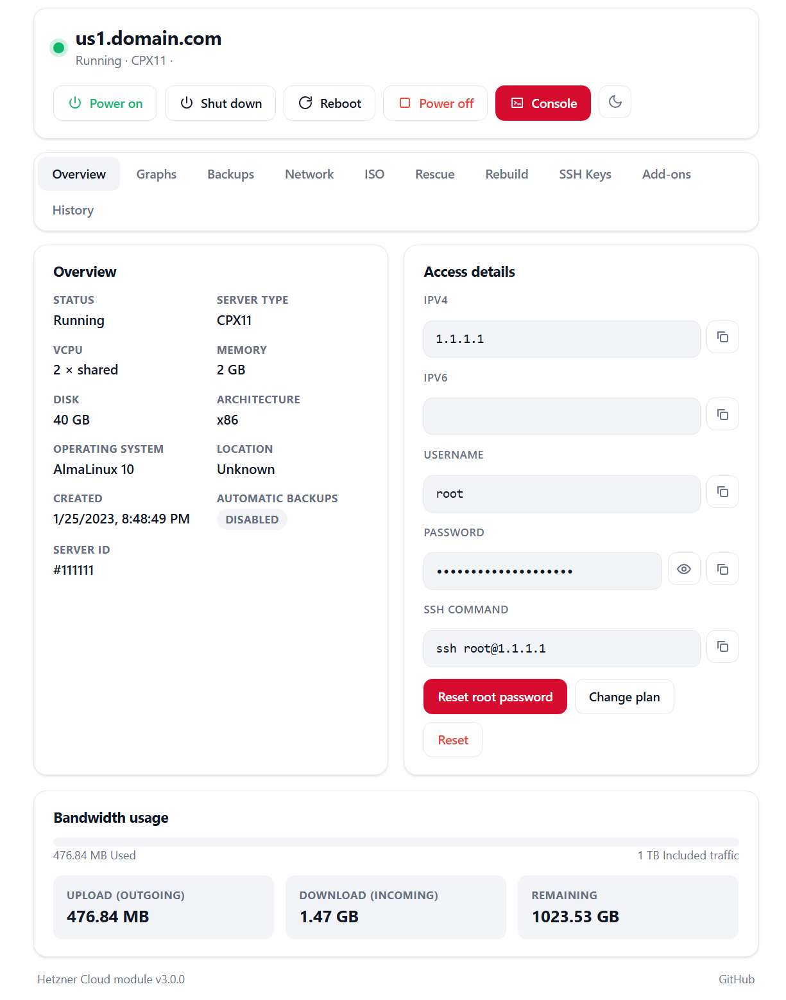
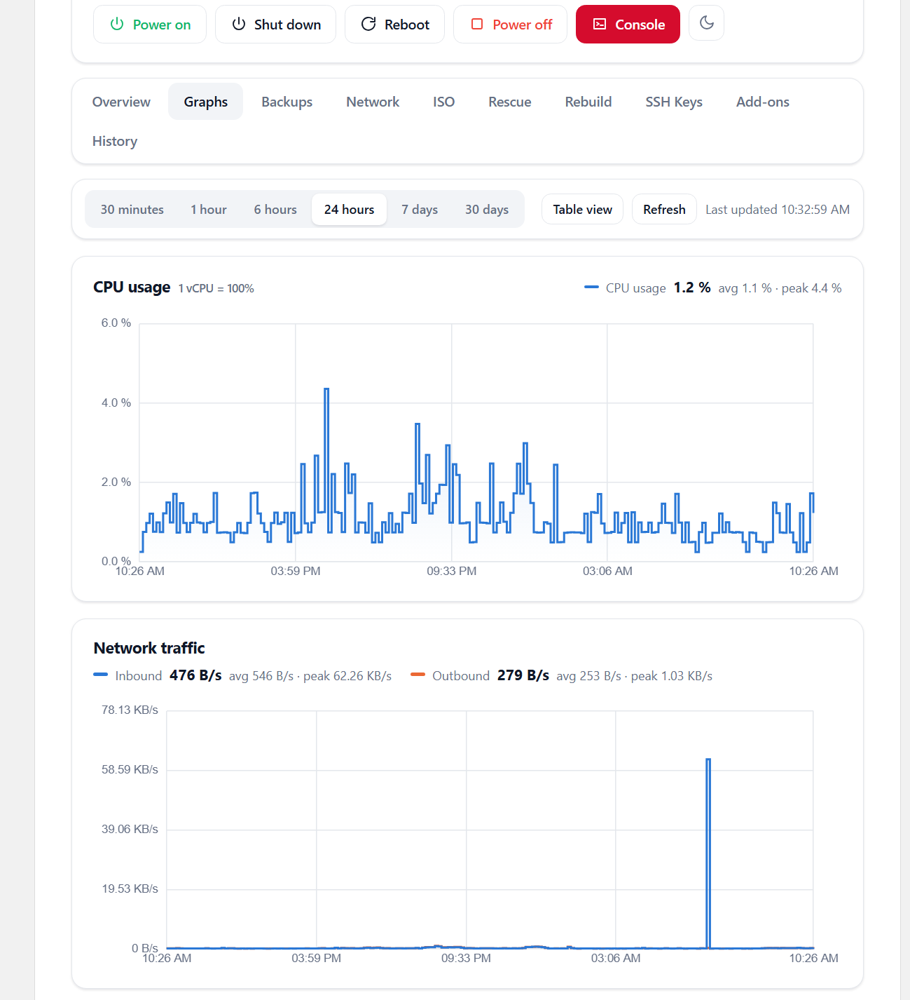
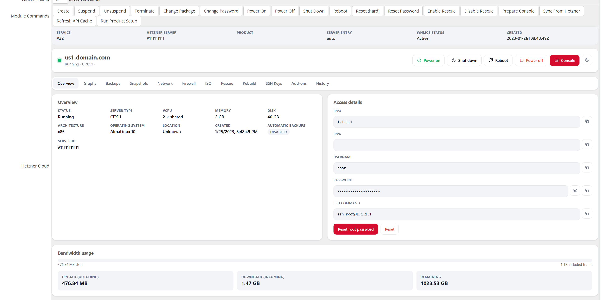
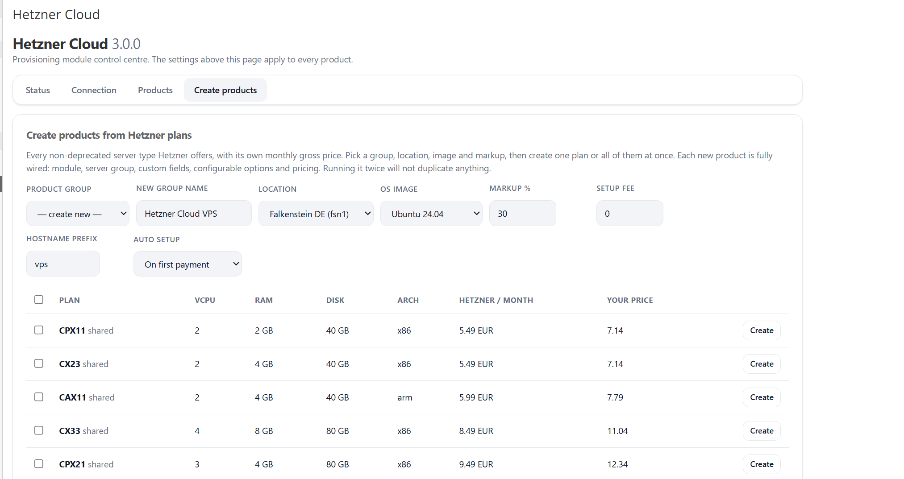

# ☁️ WHMCS Hetzner Cloud Module

[](https://github.com/lastwall/whmcs-hetzner-cloud-automation/releases)
[](LICENSE)
[](#-requirements)
[](#-requirements)
[](#-contributing)

A complete, free provisioning module for **Hetzner Cloud**. Orders provision a real server, and your
customer gets a self-contained control panel for power, graphs, traffic, backups, snapshots, floating
IPs, firewalls, private networks, reverse DNS, rescue mode, ISO mounting, SSH keys and a noVNC console.

Your staff get **the same panel** on the admin service page, and an addon that sets the whole thing up
from an API token — including generating one WHMCS product per Hetzner plan, priced.



<table>
<tr>
<td width="50%"><br><em>Metrics dashboard — five charts, one API call</em></td>
<td width="50%"><br><em>Floating IPs, reverse DNS and private networks</em></td>
</tr>
<tr>
<td><br><em>Admin service page — the same panel, every feature unlocked</em></td>
<td><br><em>Build a WHMCS product from every Hetzner plan</em></td>
</tr>
</table>

---

## 📑 Contents

- [What's new in 3.0](#-whats-new-in-30)
- [Features](#-features)
- [Quick start](#-quick-start)
- [Product settings](#-product-settings)
- [Turning features on and off](#-turning-features-on-and-off)
- [Selling add-ons](#-selling-add-ons)
- [The metrics dashboard](#-the-metrics-dashboard)
- [Upgrading from 2.x](#-upgrading-from-2x)
- [Requirements](#-requirements)
- [Security](#-security)
- [Troubleshooting](#-troubleshooting)
- [Contributing](#-contributing)
- [Licence](#-licence)

---

## ✨ What's new in 3.0

Version 3 is a full rewrite. Everything below is new or rebuilt:

| Area | Change |
|------|--------|
| **Panel** | Brand-new tabbed client area: own design system, automatic light/dark theme, RTL support, no Bootstrap or jQuery dependency, works identically on Six / Twenty-One / custom themes |
| **Features** | Snapshots, backups, floating IPs, firewalls with a rule editor, private networks (subnets + routes + attach), IPv4/IPv6 reverse DNS, rescue mode, SSH keys, task history, traffic meter |
| **Admin** | The **same control panel** as the client area on the service page — every tab, chart and action — plus the WHMCS module commands and a facts strip |
| **Setup** | Paste an API token and the WHMCS server entry, server group and database tables are created for you |
| **Product generator** | Lists every Hetzner plan with live pricing and builds finished WHMCS products — one at a time or all at once, with markup, group, location, image and full module configuration |
| **Feature matrix** | 21 client-area features switchable per product, enforced in the UI *and* the API layer |
| **Metrics** | Five charts from a single API call, colourblind-validated palette, crosshair tooltips, table view, auto refresh |
| **Addon** | Four-tab control centre: Status, Connection, Products, Create products |
| **Languages** | 11 shipped translations with English fallback, plain editable `$_LANG` files |
| **API client** | Rewritten: pagination, action polling, module-log integration, response caching, timeout capped below PHP's execution limit |
| **Security** | CSRF on every state change (client, admin **and** addon), per-resource ownership checks via Hetzner labels, console credentials kept server-side, no `mysql_*` calls |

---

## 🧩 Features

### Client side
- Server info with live status polling
- Power On / Off, Shut Down, Reboot, Reset
- View and reset the root password, copy-ready SSH command
- Change plan (routes through the WHMCS upgrade and billing flow)
- Bandwidth meter plus upload / download counters
- **Metrics dashboard** — CPU, network throughput, network packets, disk throughput, disk IOPS,
  30 minutes → 30 days, crosshair tooltips, current/avg/peak, table view
- Rescue mode; rebuild with any Hetzner image or app image
- Backups: enable / disable, list, restore
- Snapshots: create, list, delete, restore
- Floating IPs: order, assign, unassign, delete, set PTR
- Firewalls: create, delete, rule editor, apply to / remove from the server
- Private networks: create, delete, subnets, routes, attach / detach the server
- IPv4 and IPv6 reverse DNS
- ISO images: search, mount, unmount
- SSH keys: add, list, delete — plus an SSH key field at order time
- Task history from the Hetzner action log
- Add-ons tab with configurable-option pricing
- noVNC console with paste-as-typing
- 11 languages, RTL layouts, light and dark theme

### Admin side
The admin service page runs **the same panel**, with every feature switch overridden on for staff and a
workable allowance even when the product sells none. On top of it:

- Create / Suspend / Unsuspend / Terminate (WHMCS module commands)
- Change Package — upgrade or downgrade, grows the disk when moving up
- A facts strip: service id, Hetzner server id, product, server entry, WHMCS status, created
- One-click power, password reset, rescue, console preparation, sync from Hetzner, product setup
- Generate products, custom fields and configurable options

---

## 📦 Contents

```
modules/servers/hetznercloud/     provisioning module
  ├── hetznercloud.php            WHMCS entry points (config, provisioning, admin)
  ├── api.php                     Hetzner REST client + cached reference data
  ├── functions.php               feature layer (power, snapshots, firewalls, …)
  ├── panel.php                   the control panel markup — shared by both sides
  ├── clientarea.php              client controller + JSON endpoint
  ├── admin.php                   admin panel + its JSON endpoint
  ├── storage.php                 module tables, settings, feature matrix, CSRF/crypto helpers
  ├── setup.php                   custom fields, config options, product generator
  ├── lang.php, lang/*.php        translations
  ├── console.php                 noVNC page
  ├── noVNC/                      bundled noVNC 1.0.0 (MPL-2.0)
  └── templates/                  clientarea.tpl, style.css, script.js
modules/addons/hetznercloud/      settings, setup and diagnostics addon
```

The client area and the admin service page render **the same panel from the same file**. They differ
only in the JSON endpoint they call and whether the per-product feature switches apply.

---

## 📖 Quick start

### 1. Upload

Copy both module folders into your WHMCS root, keeping the paths:

```
<whmcs>/modules/servers/hetznercloud
<whmcs>/modules/addons/hetznercloud
```

`modules/servers/hetznercloud/cache/` is created automatically and must be writable by PHP.

### 2. Activate the addon

**Setup → Addon Modules → Hetzner Cloud → Activate.** This creates the module database tables.

The addon page is organised into four tabs:

| Tab | What lives there |
|-----|------------------|
| **Status** | Connection / database / product counts, a getting-started checklist, tracked resources, cache refresh, languages |
| **Connection** | Paste an API token, see every server entry and whether its stored token has the right shape |
| **Products** | One panel per product: setup state, Run setup, the client-area feature matrix and the limits |
| **Create products** | The Hetzner plan table and the product generator |

Settings on the addon's own configuration screen:

| Setting | Purpose |
|---------|---------|
| Default panel language | Used when the client has no language of their own |
| Accent colour | Hex colour for buttons and highlights in the panel |
| Auto-create custom fields | Create `serverID` / `ssh_key` automatically when a product needs them |
| Clean up on termination | Delete floating IPs, volumes, snapshots, firewalls, networks and SSH keys with the server |
| Status refresh | Client-side polling interval in seconds (0 disables) |
| API timeout | Max seconds per Hetzner call, always capped below PHP's `max_execution_time` |


### 3. Connect the API token

**Addons → Hetzner Cloud → Connection.** Paste a token created in the Hetzner Console under
*Project → Security → API tokens* with **Read & Write** permission, then press **Verify & save**.

The module validates the token against the API and then, without you touching
*Setup → Products/Services → Servers*:

- creates or updates the WHMCS server entry
- creates the **Hetzner Cloud** server group and puts the server in it
- refreshes the API cache

The table underneath shows every server entry and whether its stored token has the right shape, so a
truncated or line-broken paste is obvious at a glance.

> Prefer doing it by hand? **Setup → Products/Services → Servers → Add New Server**, module
> *Hetzner Cloud Server Automation*, token in **Access Hash**, then **Test Connection**.

### 4. Create the products — automatically

**Addons → Hetzner Cloud → Create products** lists every non-deprecated server type with its Hetzner
monthly price. Choose:

| Control | Effect |
|---------|--------|
| Product group | An existing WHMCS group, or *create new* using the name beside it |
| Location / OS image | Written into the new product's module settings |
| Markup % | Sale price = Hetzner price × (1 + markup). The **Your price** column updates as you type |
| Setup fee, hostname prefix, auto setup | Applied to every product created in this run |

Press **Create** on one row, or tick several and press **Create selected products**. Each product is
created with the module and server group selected, all module settings filled in, the `serverID` and
`ssh_key` custom fields, a full configurable option group, and monthly pricing in every currency.

Safe to press twice — a plan that already has a product for the same type and location is skipped.

> **One product per plan means no plan picker.** A generated product fixes its server type, so the
> configurable option group deliberately leaves *Server Type* out; otherwise a customer could switch
> from the cheapest plan to the largest in the cart at no extra cost. The rule is automatic: whenever a
> product names a server type in its module settings the picker is omitted, and an existing one is
> hidden the next time setup runs. For a single multi-plan product, leave **Server Type** blank in the
> module settings — setup then offers the picker and prices every entry from the Hetzner list.

Prices come from Hetzner in **gross EUR** and are written into your default currency **without
conversion** — review them if you do not bill in EUR.

### 5. Or build a product by hand

**Setup → Products/Services → Products → Create a New Product**, module
`Hetzner Cloud Server Automation`. Set the defaults on **Module Settings**, then set
**Auto Setup Product → Run setup now** and save. The module creates the custom fields, the
configurable option group and the server group assignment, then resets the dropdown to *No*.

---

## ⚙️ Product settings

| # | Setting | Purpose |
|---|---------|---------|
| 1 | Server Name Prefix | Used when the order carries no hostname → `prefix-serviceid` |
| 2 | Server Type | Default plan. Leave blank to offer a plan picker instead |
| 3 | Location | Default datacenter |
| 4 | OS Image | Default operating system |
| 5 | Enable Backups | Turn on Hetzner backups at provisioning |
| 6 | Auto Mount Volume | Mount the extra volume inside the server |
| 7 | Volume Size (GB) | 0 = no extra volume, minimum 10 GB |
| 8 | Volume Format | ext4 or XFS |
| 9 | Number Of Floating IPs | Floating IPs created with the server |
| 10 | Floating IP Protocol | IPv4, IPv6 or both |
| 11 | Price Per Additional Floating IP | Displayed in the panel |
| 12–16 | Snapshot / Firewall / Inbound / Outbound / Network limits | Defaults for the client-area allowances |
| 17 | Auto Setup Product | Select *Run setup now* and save |

Configurable options always win over the product default, so one product can serve every location and
image combination.

---

## 🎛 Turning features on and off

Client-area features are **not** product settings — WHMCS only gives a module 24 configoption slots,
which is not enough for one switch per feature. They live in **Addons → Hetzner Cloud → Products**,
with a panel per product:

| Group | Switches |
|-------|----------|
| Server | Power controls, reset root password, console, rebuild, rescue, ISO, change-plan link |
| Monitoring | Graphs, bandwidth usage, task history |
| Data | Show backups, let the client toggle backups, snapshots, show volumes |
| Network | Show floating IPs, let the client order floating IPs, reverse DNS, private networks, firewalls |
| Access | SSH keys, add-ons tab |

Everything defaults to **on** except the two marked *billable*, so a product an admin never touched
still gets the full panel. Unticking a box hides the section **and** rejects the matching API call, so
it cannot be reached by crafting a request.

Underneath each product are the numeric limits (snapshots, firewalls, rules per direction, private
networks, floating IPs). Leave one blank to inherit the product setting or configurable option.

### Billable features

Two switches cost the customer money at Hetzner and are **off by default**:

- **Let the client switch backups on/off** — Hetzner adds 20% to the server price
- **Let the client order floating IPs** — each IP is billed monthly

Leave them off and sell the capability as a configurable option instead. Turn them on only if you are
happy for the customer to add Hetzner cost without an invoice.

---

## 💳 Selling add-ons

The **Add-ons** tab lists the product's configurable options — backups, extra floating IPs, snapshot
allowance, firewall allowance — with the price for the customer's currency and what they hold today.
The button beside it opens the standard WHMCS configurable-options upgrade page, so the purchase is
quoted, invoiced and paid before anything changes on the server. `ChangePackage` then reconciles it.

Generated products are priced automatically where Hetzner charges a real cost:

| Option | Price |
|--------|-------|
| Enable Backup | 20% of the product's monthly price |
| Floating IPs | the Hetzner floating IP price × your markup, per unit |

Everything else starts at 0 so you can set your own margin under
**Setup → Products/Services → Configurable Options**. Re-running setup never overwrites a price you
have already set.

---

## 📈 The metrics dashboard

The Graphs tab is a real monitoring dashboard rather than one chart with a toggle:

- **Five charts, one per full-width row, one unit each** — CPU %, network throughput, network packets,
  disk throughput, disk IOPS. Never two y-scales on one plot.
- **Stepped lines**, like the Hetzner console. Each point is an average over the sampling step, so a
  step states what was measured; a smooth curve would invent motion between samples.
- **Axes scale to the data.** A 1%-idle server fills its CPU chart instead of drawing a flat line.
- **One range filter above them all** — 30 m, 1 h, 6 h, 24 h, 7 d, 30 d, scoping every chart.
- **One API call** — Hetzner accepts a comma-separated metric list.
- **Crosshair tooltips** reading every series at the hovered time, value first, 24 px hit area.
- **Current, average and peak** per series, as text beside the colour key.
- **Table view** — one button swaps every chart for its data table, so no value is hover-only.
- **Auto refresh** every 60 s while the tab is open; a refresh dims the charts instead of flashing.

Colours are a two-slot categorical palette validated for colourblind separation against this module's
own light and dark surfaces (worst adjacent pair ΔE 24.7 light / 26.8 dark under simulated
protanopia). Dark mode uses its own steps of the same hues rather than an automatic flip.

---

## ⬆️ Upgrading from 2.x

3.0 is a rewrite. Read this before upgrading a live install.

1. **Back up** your WHMCS database and the existing `modules/servers/hetznercloud` folder.
2. **Replace** the module folder and add `modules/addons/hetznercloud`.
3. **Activate the addon** — it creates `mod_hetznercloud_resources` and `mod_hetznercloud_settings`.
4. **Product settings renumbered.** 3.0 removed the seven `Client Area: *` yes/no fields, so
   *Auto Setup Product* moved from slot 24 to slot 17. Open each product's **Module Settings** tab and
   confirm the values, then press **Run setup**.
5. **Feature visibility moved** to Addons → Hetzner Cloud → Products, and defaults to on.
6. **Existing services keep working.** The Hetzner id is still read from the `serverID` custom field.
   Press **Sync From Hetzner** on a service to backfill IPs and populate the resource cache.
7. **Existing generated products** may still carry a free Server Type picker — press **Run setup** to
   hide it.

Nothing at Hetzner is modified by the upgrade. Resources created by 2.x carry no labels, so they will
not appear in the client panel's lists until they are recreated or manually labelled
`whmcs_service=<id>`.

---

## 🧪 Requirements

| | |
|---|---|
| WHMCS | 8.x and 9.x (module API 1.1) |
| PHP | 7.4 → 8.3 |
| Extensions | cURL, JSON, OpenSSL |
| Hetzner | API token with **Read & Write** permission |
| Network | Outbound HTTPS to `api.hetzner.cloud`; the console needs a browser that can reach `wss://*.hetzner.cloud` |

All database access goes through WHMCS's Capsule query builder, and every WHMCS helper that has been
deprecated across major versions (`generate_token`, `encrypt`, `decrypt`, `$_SESSION['adminid']`) is
called behind a wrapper with a fallback, so a change in WHMCS 9 degrades instead of fatalling. No
legacy `mysql_*` or `*_query()` calls remain. Every file parses clean under PHP 8.3 with `E_ALL`.

---

## 🔒 Security

| Control | How |
|---|---|
| **Client authorisation** | The JSON endpoint is the WHMCS product-details route, so WHMCS has already proven the service belongs to the logged-in client before the module sees it |
| **Admin authorisation** | `admin.php` checks the WHMCS admin session on every call via `CurrentUser`, falling back to the session key |
| **CSRF** | Session token, constant-time compared, on every state change — client panel, admin panel **and** the addon page. Read-only calls are GET; everything that changes state is POST-only |
| **Resource ownership** | All 12 mutating resource actions re-check the Hetzner label before touching a floating IP, firewall, network, snapshot or SSH key — a customer cannot reach another customer's resource by guessing an id |
| **Feature gating** | Disabling a feature hides the UI *and* rejects the matching API call |
| **SQL injection** | Capsule query builder throughout; the single `selectRaw` is a constant `COUNT(*)` with no user input |
| **XSS** | Server-rendered output escapes with `htmlspecialchars(ENT_QUOTES)`; the front-end escapes every API value before insertion; chart tooltips are canvas-drawn, not DOM |
| **Secrets** | The API token is shape-checked and stripped of control characters before reaching an HTTP header; console credentials live in the PHP session and never appear in a URL; root passwords use WHMCS's own encryption, and the module refuses to store one at all if `encrypt()` is unavailable rather than writing plaintext |
| **Request routing** | `$_GET`/`$_POST` read explicitly — never `$_REQUEST`, which carries cookies on hosts that leave `request_order` unset |
| **Cache** | Keys are sanitised against traversal; the cache directory ships `.htaccess` + `index.html` |
| **Transport** | HTTPS pinned, `SSL_VERIFYPEER` and `VERIFYHOST=2` on, API timeout capped below PHP's execution limit |

### Not covered

- **No rate limiting on client actions.** A customer can repeatedly power-cycle their own server.
  Hetzner's own limit (3600 requests/hour per token) applies; add a WHMCS-level throttle if you need more.
- **The panel trusts WHMCS's session** and inherits whatever session hardening your WHMCS has.

Found something? Open an issue, or email the maintainer for anything sensitive.

---

## 💡 Troubleshooting

**Nothing appears in the client area**
Check **Utilities → Logs → Module Log** — every API call is logged there with the token redacted.

**Dropdowns on the product page are empty**
The API token is wrong or blocked. Re-paste it in **Addons → Hetzner Cloud → Connection**, then press
**Refresh API cache** on the Status tab.

**"Hetzner API returned HTTP 400"**
The token was sent but was not a usable string — usually a paste that carried a line break, or an
access hash stored in a form WHMCS could not decrypt. Re-paste it; the *Stored token* column tells you
whether the saved value has the right shape. HTTP 401 or 403 means the token itself is wrong or lacks
Read & Write permission.

**"This service has no Hetzner server attached"**
The `serverID` custom field is missing or empty. Run the product setup, paste the Hetzner server id
into the field and press **Sync From Hetzner**.

**Console shows "session expired"**
Console sessions last 10 minutes. Open it again from the service page (admins: press **Prepare
Console** first).

**Pasting into the console**
Press **Paste**, put the text in the box (Ctrl+V works there even when the browser blocks clipboard
reads) and press Send. The text is typed one keystroke at a time — a bare VM console has no clipboard
manager. Ctrl+Enter sends, Escape cancels.

**The order form lets a customer change the server type for free**
That product was generated before this rule existed. Press **Run setup** on it in
**Addons → Hetzner Cloud → Products**; the Server Type picker is hidden (not deleted, so existing
orders keep their values).

**A tab is missing from the client panel**
Feature visibility is per product in **Addons → Hetzner Cloud → Products**. Snapshots, firewalls and
private networks also need their limit above 0, and floating-IP ordering is off by default.

**Change Package does nothing**
Hetzner cannot shrink a disk. Downgrades keep the current disk size; upgrades grow it automatically.

**The panel looks half-styled after an update**
Assets are cache-busted from each file's modification time, so this should not happen; if it does,
hard-refresh once (Ctrl+Shift+R).

**The product page occasionally renders empty**
A Hetzner API call that outran PHP's `max_execution_time` used to kill the page mid-render. The API
timeout is now always held below that limit, a render failure shows a message instead of a blank area,
and the panel retries the first load from the browser.

---

## 🌍 Translations

Shipped: English, German, French, Spanish, Italian, Dutch, Persian (Farsi), Arabic, Russian, Polish,
Turkish. Persian and Arabic render the panel right-to-left.

Files live in `modules/servers/hetznercloud/lang/<whmcs-language>.php` and use the plain WHMCS format:

```php
$_LANG['power_on'] = 'Power on';
```

Add a language by copying `english.php` to the WHMCS language name (e.g. `portuguese-br.php`) and
translating the values. Missing keys fall back to English, so a partial file is fine.

---

## 📌 Contributing

Issues and pull requests welcome. Translations are the easiest place to start — copy
`lang/english.php` and send it back.

Branches follow the major version: `version-1`, `version-2`, `version-3`.

---

## 🔄 Version history

### 3.0.0
- Full rewrite of the PHP layer, template and JavaScript
- New tabbed client panel with light/dark theme, RTL and no external CSS/JS frameworks
- Snapshots, backups, floating IPs, firewalls, private networks, reverse DNS, rescue, SSH keys, history
- Admin service page runs the same panel as the client area
- Addon module with a four-tab control centre
- Server entry, server group and product generation from a pasted API token
- 21-switch per-product feature matrix enforced in UI and API
- Metrics dashboard: five charts, one API call, validated palette, table view
- Label-based resource ownership with a local mirror table
- CSRF everywhere, ownership checks, console credentials kept server-side
- 11 languages with English fallback
- WHMCS 8/9 and PHP 7.4–8.3 compatibility

### 2.0.0
- UI redesign, real-time metrics, Chart.js graphs, ISO management, password reset, noVNC console

### 1.0.0
- Basic provisioning, status and power controls

---

## 📜 Licence

MIT — see [LICENSE](LICENSE).

This project **redistributes** third-party components that keep their own licences, most notably
**noVNC 1.0.0 under MPL-2.0**. See [THIRD-PARTY-NOTICES.md](THIRD-PARTY-NOTICES.md) before
redistributing.

**Hetzner** and **Hetzner Cloud** are trademarks of Hetzner Online GmbH. This is an independent,
unofficial integration and is not affiliated with or endorsed by Hetzner Online GmbH or WHMCS Ltd.

---

⭐ If this module is useful to you, please star the repository.
